# NoDebris — Chrome Bookmark Cleaner

A command-line and web tool to clean up your Chrome bookmarks. Find duplicates, detect broken links, auto-categorize, and flatten deep folder structures.



## Features

- **Duplicate detection** — find identical URLs across folders, keep one, remove the rest
- **Broken link checker** — HTTP HEAD requests with GET fallback, concurrent with progress bar
- **Redirect detection** — flag 3xx responses before you click
- **Auto-categorization** — suggest folders based on domain rules (GitHub → Dev, YouTube → Video, etc.)
- **Folder structure analysis** — detect empty folders, shallow folders (1–2 items), and deep nesting (>3 levels)
- **Export to Chrome** — generate a clean Netscape HTML file ready for import
- **Dual mode** — CLI for quick reports, web UI for interactive cleanup

## Quick Start

### Install

```bash
go install github.com/philyuchkoff/NoDebris/cmd/nodebris@latest
```

Or build from source:

```bash
git clone https://github.com/philyuchkoff/NoDebris
cd NoDebris
make build
# binary at bin/nodebris
```

### Run the web interface

```bash
./nodebris serve
```

Open http://localhost:8080, upload your bookmarks export file, and start cleaning.

### CLI quick analysis

```bash
nodebris analyze bookmarks.html
```

Outputs total bookmarks, duplicate groups, folder structure problems, and categorization suggestions — all in the terminal.

## How to export bookmarks from Chrome

1. Open Chrome → **Bookmark Manager** (`Cmd+Shift+O` / `Ctrl+Shift+O`)
2. Click the **⋮** menu → **Export bookmarks**
3. Save the `.html` file

Alternatively, NoDebris can read Chrome's profile directly: point it to the `Bookmarks` JSON file (usually at `~/Library/Application Support/Google/Chrome/Default/Bookmarks` on macOS).

## Usage

### Web interface

| Screen | What it does |
|--------|-------------|
| **Upload** | Drag-and-drop an HTML export or paste a path to Chrome profile |
| **Bookmarks** | Full table with search, filters (broken/redirect/duplicate), bulk delete/move, and a one-click link checker |
| **Duplicates** | Cards grouped by URL, radio buttons to pick which copy to keep |
| **Structure** | Folder tree with suggestions: merge shallow folders, remove empty ones |
| **Export** | Download a cleaned Netscape HTML file for Chrome import |

### CLI

```
nodebris serve                 start web server on :8080
nodebris analyze <file>        print analysis to stdout
```

### Custom categorization rules

Create a `categories.json` file next to the binary:

```json
[
  {"domain": "github.com",   "category": "Dev/GitHub"},
  {"domain": "stackoverflow.com", "category": "Dev/StackOverflow"},
  {"domain": "youtube.com",  "category": "Video"},
  {"domain": "habr.com",     "category": "Articles"}
]
```

## Project structure

```
NoDebris/
├── cmd/nodebris/    # entry point (serve + analyze)
├── internal/
│   ├── parser/              # HTML export & Chrome JSON parsers
│   ├── model/               # Bookmark data model
│   ├── analyzer/            # duplicates, link checker, categorizer, structure
│   ├── exporter/            # Netscape HTML generator
│   └── server/              # HTTP server, handlers, Go templates
├── web/static/              # CSS
├── Makefile
└── docs/plans/              # design doc & roadmap
```

## Tech stack

- **Backend:** Go (stdlib `net/http`, `html/template`)
- **Frontend:** HTMX + PicoCSS
- **No JavaScript framework, no database, no external runtime**

## License

MIT
