# NoDebris — чистильщик закладок Chrome

Инструмент командной строки и веб-интерфейс для наведения порядка в закладках Google Chrome: поиск дубликатов, проверка битых ссылок, авто-категоризация и упрощение структуры папок.



## Возможности

- **Поиск дубликатов** — группировка одинаковых URL по папкам, выбор и удаление лишних
- **Проверка битых ссылок** — HTTP HEAD-запросы с fallback на GET, параллельная проверка с индикатором прогресса
- **Обнаружение редиректов** — пометка ссылок с 3xx-редиректами
- **Авто-категоризация** — предложение папок по доменным правилам (GitHub → Разработка, YouTube → Видео и т.д.)
- **Анализ структуры папок** — поиск пустых папок, папок с 1–2 закладками и слишком глубокой вложенности
- **Экспорт в Chrome** — генерация чистого HTML-файла в формате Netscape для импорта обратно
- **Два режима** — CLI для быстрого отчёта, веб-интерфейс для интерактивной чистки

## Быстрый старт

### Установка

```bash
go install github.com/philyuchkoff/NoDebris/cmd/bookmark-cleaner@latest
```

Или собрать из исходников:

```bash
git clone https://github.com/philyuchkoff/NoDebris
cd NoDebris
make build
# бинарник в bin/nodebris
```

### Запуск веб-интерфейса

```bash
nodebris serve
```

Открой http://localhost:8080, загрузи файл экспорта закладок и начинай чистку.

### Быстрый анализ в консоли

```bash
nodebris analyze bookmarks.html
```

Выводит общее число закладок, группы дубликатов, проблемы структуры и предложения категорий.

## Как экспортировать закладки из Chrome

1. Открой Chrome → **Диспетчер закладок** (`Cmd+Shift+O` / `Ctrl+Shift+O`)
2. Нажми **⋮** → **Экспортировать закладки**
3. Сохрани файл `.html`

Также NoDebris умеет читать профиль Chrome напрямую: укажи путь к файлу `Bookmarks` (обычно `~/Library/Application Support/Google/Chrome/Default/Bookmarks` на macOS).

## Использование

### Веб-интерфейс

| Экран | Что делает |
|-------|-----------|
| **Загрузка** | Drag-and-drop HTML-файла или путь к профилю Chrome |
| **Закладки** | Таблица с поиском, фильтрами (битые/редиректы/дубликаты), массовым удалением/перемещением и кнопкой проверки ссылок |
| **Дубликаты** | Карточки групп с радио-кнопками — какую копию оставить |
| **Структура** | Дерево папок с рекомендациями: слить мелкие папки, удалить пустые |
| **Экспорт** | Скачать очищенный Netscape HTML для импорта в Chrome |

### CLI

```
nodebris serve                 запуск веб-сервера на :8080
nodebris analyze <файл>        вывод анализа в консоль
```

### Свои правила категоризации

Создай файл `categories.json` рядом с бинарником:

```json
[
  {"domain": "github.com",   "category": "Разработка/GitHub"},
  {"domain": "stackoverflow.com", "category": "Разработка/StackOverflow"},
  {"domain": "youtube.com",  "category": "Видео"},
  {"domain": "habr.com",     "category": "Статьи"}
]
```

## Структура проекта

```
NoDebris/
├── cmd/bookmark-cleaner/    # точка входа (serve + analyze)
├── internal/
│   ├── parser/              # парсеры HTML-экспорта и Chrome JSON
│   ├── model/               # модель данных Bookmark
│   ├── analyzer/            # дубликаты, проверка ссылок, категоризация, структура
│   ├── exporter/            # генератор Netscape HTML
│   └── server/              # HTTP-сервер, обработчики, Go-шаблоны
├── web/static/              # CSS
├── Makefile
└── docs/plans/              # дизайн-документ и план задач
```

## Технологии

- **Бэкенд:** Go (stdlib `net/http`, `html/template`)
- **Фронтенд:** HTMX + PicoCSS
- **Без JS-фреймворков, без базы данных, без внешнего рантайма**

## Визуальный стиль

«Тихий административный дашборд» в светлых тонах: фон `#FAFBFC`, точечные цветные статусы (`#10B981` — живая, `#EF4444` — битая, `#F59E0B` — редирект), акцент на данных без визуального шума.

## Лицензия

MIT
